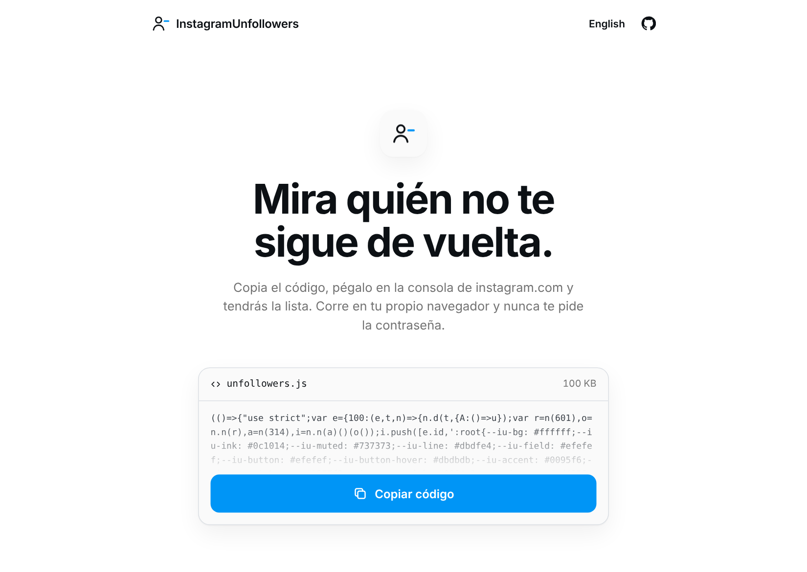

# InstagramUnfollowers

[Español](#español) · [English](#english)

## Español

Muestra qué cuentas de las que sigues no te siguen de vuelta. Corre en tu navegador, dentro de tu sesión de Instagram: no hay que instalar nada y no pide la contraseña.

Es un fork de [InstagramUnfollowers](https://github.com/davidarroyo1234/InstagramUnfollowers) de David Arroyo. La idea y la base son suyas; en este fork se rehízo la forma de comprobar quién te sigue, que en cuentas grandes daba falsos "no te sigue", y se simplificó la interfaz. Más abajo está el detalle.

**Para copiar el código:** https://cperez233.github.io/InstagramUnfollowers/

### Cómo se usa

1. Abre la página de arriba y pulsa **Copiar código**.
2. Entra a [instagram.com](https://www.instagram.com/) desde el ordenador e inicia sesión.
3. Abre la consola (`Ctrl + Shift + J` en Windows y Linux, `⌘ + ⌥ + J` en Mac), pega el código y pulsa `Enter`.
4. Pulsa **Escanear**. Las cuentas que no te siguen van apareciendo mientras se revisa el resto.

Desde la lista puedes abrir cada perfil, buscar, ocultar las cuentas verificadas y copiar la lista de usuarios. Las cuentas que te dan igual (marcas, amigos que no usan Instagram) se pueden ignorar: pasan a la pestaña *Ignoradas* y no vuelven a salir en los siguientes escaneos. También puedes dejar de seguir a una cuenta con el botón *Siguiendo*, que pide confirmación.

El último escaneo queda guardado en el navegador, así que puedes volver a verlo sin escanear otra vez.

Escanear tarda alrededor de un segundo por cada cuenta que sigues. Si Instagram empieza a limitar las peticiones, el escaneo se detiene y te enseña lo que ya alcanzó a comprobar; en ese caso conviene esperar unas horas antes de repetirlo.

En el móvil no hay consola. En Android funciona con el navegador [Eruda](https://github.com/liriliri/eruda-android/releases/), que trae una.

### Qué cambia respecto al original

**Cómo se comprueba quién te sigue.** La versión original descargaba la lista completa de tus seguidores y la cruzaba con la de seguidos. Instagram entrega esa lista en tandas de 12 a 25 personas, así que una cuenta con miles de seguidores necesitaba cientos de peticiones. Bastaba con que una fallara, o con que Instagram cortara la lista antes de tiempo, para que gente que sí te sigue apareciera como que no.

Ahora se carga la lista de cuentas que sigues y, para cada una, se consulta `/api/v1/friendships/show/<id>/`, que responde directamente si esa cuenta te sigue (`followed_by`). El número de peticiones depende de cuántas cuentas sigues, no de cuántos seguidores tienes.

Si sigues a muchas más cuentas de las que te siguen, sale más barato recorrer tus seguidores, y entonces se hace como antes, con una diferencia: el resultado solo se da por bueno si se cargó al menos el 97 % de tus seguidores. Si no, el escaneo avisa del error en lugar de mostrar una lista equivocada.

Antes de quedarnos con esto probamos otras vías. `friendships/show_many` devuelve HTML cuando se llama desde la web, `web_profile_info` responde con 429 casi enseguida, y buscar cada cuenta dentro de tus seguidores devolvía resultados vacíos para cuentas que sí te seguían.

**La interfaz.** Ahora es una sola lista con el aspecto de Instagram, y sigue su tema claro u oscuro. Se quitó lo que no hace falta para ver quién no te sigue: los filtros de cuentas privadas y sin foto, seleccionar todo, dejar de seguir en bloque, la exportación a JSON y CSV, y el panel de ajustes. Dejar de seguir ahora se hace de una en una, como en la propia app.

**La página para copiar el código.** Se rehízo con los pasos a la vista y un marcador que se puede arrastrar a la barra del navegador.

### Desarrollo

- Node 16 o superior.
- `npm install`
- `npm run webpack-build` compila `dist/dist.js`.
- `npm run build` compila y además genera `public/index.html` a partir de `src/page/index.html`. Esto lo hace GitHub Actions al publicar en cada push a `master`. No edites `public/index.html` a mano: los PR que lo modifican se rechazan.
- Para probar la interfaz sin Instagram, sirve la raíz del repo y abre `http://localhost:<puerto>/public/preview.html?preview=results` (o `?preview=live` para ver un escaneo en curso). En `localhost` se usan datos de prueba.

### Licencia

MIT. El proyecto original es de David Arroyo y sus colaboradores; ver [LICENSE](LICENSE).

---

## English

Shows which of the accounts you follow don't follow you back. It runs in your browser, inside your Instagram session: nothing to install, and it never asks for your password.

This is a fork of David Arroyo's [InstagramUnfollowers](https://github.com/davidarroyo1234/InstagramUnfollowers). The idea and the groundwork are his; this fork changes how it checks who follows you, which gave false "doesn't follow you" results on large accounts, and simplifies the interface. Details below.

**Copy the code here:** https://cperez233.github.io/InstagramUnfollowers/

### How to use it

1. Open the page above and click **Copy code**.
2. Go to [instagram.com](https://www.instagram.com/) on a computer and log in.
3. Open the console (`Ctrl + Shift + J` on Windows and Linux, `⌘ + ⌥ + J` on a Mac), paste the code and press `Enter`.
4. Click **Scan**. Accounts that don't follow you back show up while the rest are being checked.

From the list you can open each profile, search, hide verified accounts and copy the usernames. Accounts you don't care about (brands, friends who don't use Instagram) can be ignored: they move to the *Ignored* tab and stay out of later scans. You can also unfollow an account with its *Following* button, which asks you to confirm.

The last scan is saved in the browser, so you can look at it again without scanning.

A scan takes about a second per account you follow. If Instagram starts limiting requests, the scan stops and shows what it had already checked; wait a few hours before running it again.

Mobile browsers have no console. On Android it works with the [Eruda](https://github.com/liriliri/eruda-android/releases/) browser, which adds one.

### What's different from the original

**How it checks who follows you.** The original downloaded your whole followers list and compared it with the accounts you follow. Instagram serves that list 12 to 25 people at a time, so an account with thousands of followers needed hundreds of requests. A single failed request, or Instagram ending the list early, was enough for people who do follow you to show up as if they didn't.

Now it loads the accounts you follow and asks `/api/v1/friendships/show/<id>/` about each one, which answers directly whether that account follows you (`followed_by`). The number of requests depends on how many accounts you follow, not on how many followers you have.

If you follow far more accounts than follow you, walking your followers is cheaper, so it does that instead, with one difference: the result only counts if at least 97% of your followers were loaded. Otherwise the scan reports an error instead of showing a wrong list.

We tried other routes first. `friendships/show_many` returns HTML when called from the web, `web_profile_info` answers 429 almost right away, and searching for each account among your followers came back empty for accounts that did follow you.

**The interface.** It's now a single list that looks like Instagram and follows its light or dark theme. Anything you don't need to see who doesn't follow you back is gone: the private and no-photo filters, select all, bulk unfollow, JSON and CSV export, and the settings panel. Unfollowing is now one account at a time, like in the app.

**The copy page.** Rebuilt, with the steps in view and a bookmark you can drag to your browser's bar.

### Development

- Node 16 or newer.
- `npm install`
- `npm run webpack-build` builds `dist/dist.js`.
- `npm run build` also generates `public/index.html` from `src/page/index.html`. GitHub Actions runs it on every push to `master` to publish the page. Don't edit `public/index.html` by hand: PRs that change it are rejected.
- To try the interface without Instagram, serve the repo root and open `http://localhost:<port>/public/preview.html?preview=results` (or `?preview=live` for a scan in progress). On `localhost` it uses sample data.

### License

MIT. The original project is by David Arroyo and its contributors; see [LICENSE](LICENSE).
