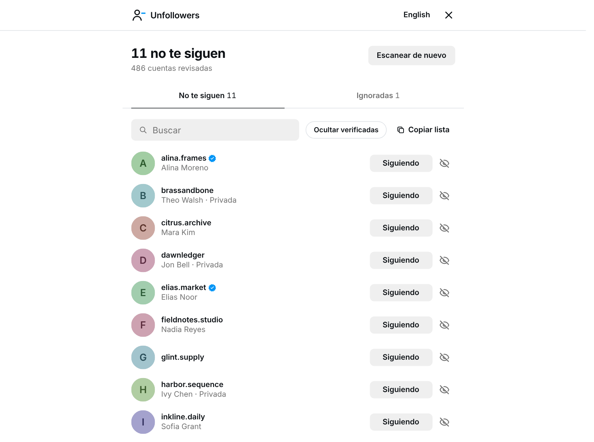

# 📱 Instagram Unfollowers

[🇬🇧 English](#-english) | [🇪🇸 Español](#-español)

---

## 🇬🇧 English

A nifty tool that lets you see who doesn't follow you back on Instagram.  
<u>Browser-based and requires no downloads or installations!</u>

> ⚡ **Live Streaming & Fast Cache:** Accounts now appear dynamically on screen in real time as batches are fetched from Instagram. In addition, completed scans are cached locally so you can reload your audit instantly (0ms) without making unnecessary API calls!

### 🖥️ Desktop Usage

1. Copy the code from: [InstagramUnfollowers Tool](https://davidarroyo1234.github.io/InstagramUnfollowers/)
2. Press the COPY button to copy the code:
    
3. Go to the Instagram website and log in to your account.
4. Open the developer console:
   - Windows / Linux: `Ctrl + Shift + J`
   - Mac OS: `⌘ + ⌥ + I`
5. Paste the code into the console and press `Enter`. You'll see this interface:
    
6. Click **"Scan"** to start (or **"See last scan"** to open your saved results instantly).
7. As the scan runs, accounts that don't follow you back appear live on screen:
    
8. 🔗 **Open any profile** by clicking its row, to review it on Instagram.
9. 🙈 **Ignore accounts** you're fine with (brands, friends) with the eye button; they move to the "Ignored" tab and stay there across scans.
10. ➖ **Unfollow** from the list with the "Following" button: click it, then confirm.
11. 🔍 **Search**, **hide verified accounts** or **copy the list** of usernames from the bar above the list.
12. 🌐 **Switch language** between English and Spanish from the top bar. The view follows Instagram's light or dark theme.

### 📱 Mobile Usage

For Android users who want to use it on mobile:
1. Download the latest version of [Eruda Android Browser](https://github.com/liriliri/eruda-android/releases/)
2. Open Instagram web through the Eruda browser
3. Follow the same steps as desktop (the console will be automatically available when clicking the Eruda icon)

### ✨ Features

- 🔍 **Scan & Detect**: Accurately identifies users who don't follow you back.
- ⚡ **Live Progressive Streaming**: Accounts stream dynamically onto your screen as each batch arrives, eliminating blank waiting screens on large accounts.
- ⚡ **Instant Local Cache (0ms load)**: Re-open and review previously completed audits instantly without re-scraping from scratch.
- 🌐 **Bilingual (EN / ES)**: Native English and Spanish support with instant switching.
- 🛡️ **Anti-Ban & Session Protection**: Uses full Instagram Web headers (`X-ASBD-ID`, `X-CSRFToken`, `XMLHttpRequest`) to prevent forced logouts and suspicious activity flags.
- 🛡️ **Action-Block Guard**: Double-checks unfollow API responses to prevent ghost unfollows; stops unfollowing automatically if Instagram returns `feedback_required` to protect your account.
- ⏳ **Smart Rate-Limit & Soft-Block Backoff**: Automatically pauses and retries if Instagram returns HTTP 429 or HTTP 400 (`feedback_required`) with exponential cooldowns instead of failing.
- ⚠️ **Wrong-Detect Guard**: Expanded page limits supporting accounts with tens of thousands of followers, with safe lock preventing accidental unfollows if a scan is interrupted.
- 🙈 **Ignored accounts**: Hide the accounts you're fine with; the choice is saved locally.
- 🎨 **Feels like Instagram**: A minimal list with Instagram's own type, colors and light/dark theme.
- 🔒 **100% Client-Side Privacy**: All data is processed locally in your browser. No credentials or data are sent to external servers.

### 🛠️ Development

- Node version: Node 16+ / Node 18+ / Node 20+
- Install dependencies: `npm install`
- Build: `npm run build`
- Dev server with live reload: `npm run build-dev`
- Build only the script (leaves `public/index.html` alone): `npm run webpack-build`
- Preview the app locally: serve the repo root and open `public/preview.html?preview=results` (or `?preview=live`) on localhost.
- The copy page is generated: edit `src/page/index.html`, and `npm run build` writes `public/index.html` from it with the bundled script. Do not edit `public/index.html` manually: GitHub Actions regenerates it, and PRs that modify it are rejected.

---

## 🇪🇸 Español

Una herramienta práctica y ligera que te permite ver quién no te sigue de vuelta en Instagram.  
<u>¡Funciona directamente en tu navegador y no requiere descargas ni instalaciones externas!</u>

> ⚡ **Transmisión en vivo y caché rápido:** Ahora las cuentas aparecen dinámicamente en pantalla en tiempo real a medida que se descargan los lotes de Instagram. Además, los escaneos completados se guardan localmente para recargar tu lista al instante (0ms) sin hacer peticiones innecesarias.

### 🖥️ Uso en Computadora (Escritorio)

1. Copia el código desde la página oficial: [Herramienta InstagramUnfollowers](https://davidarroyo1234.github.io/InstagramUnfollowers/)
2. Presiona el botón **COPY** para copiar el script.
    
3. Entra a Instagram en tu navegador e inicia sesión en tu cuenta.
4. Abre la consola de desarrollador:
   - Windows / Linux: `Ctrl + Shift + J`
   - Mac OS: `⌘ + ⌥ + I`
5. Pega el código en la consola y presiona `Enter`. Verás la interfaz:
    
6. Haz clic en **"Escanear"** para comenzar (o **"Ver último escaneo"** para abrir tus resultados guardados al instante).
7. Durante el escaneo, las cuentas que no te siguen aparecen en vivo:
    
8. 🔗 **Abre cualquier perfil** haciendo clic en su fila, para revisarlo en Instagram.
9. 🙈 **Ignora las cuentas** que te dan igual (marcas, amigos) con el botón del ojo; pasan a la pestaña "Ignoradas" y se quedan ahí entre escaneos.
10. ➖ **Deja de seguir** desde la lista con el botón "Siguiendo": púlsalo y confirma.
11. 🔍 **Busca**, **oculta las cuentas verificadas** o **copia la lista** de usuarios desde la barra sobre la lista.
12. 🌐 **Cambia el idioma** entre español e inglés desde la barra superior. La vista sigue el tema claro u oscuro de Instagram.

### 📱 Uso en Móvil (Android)

Para usuarios de Android que quieran utilizarlo desde el móvil:
1. Descarga la última versión de [Eruda Android Browser](https://github.com/liriliri/eruda-android/releases/)
2. Abre la versión web de Instagram a través del navegador Eruda.
3. Sigue los mismos pasos que en la computadora (la consola estará disponible al tocar el ícono de Eruda).

### ✨ Características Principales

- 🔍 **Detección precisa**: Encuentra rápidamente a quienes sigues pero no te siguen de vuelta.
- ⚡ **Carga progresiva en vivo**: Las cuentas aparecen en pantalla en tiempo real mientras se descargan, evitando pantallas en blanco en cuentas con muchos seguidos.
- ⚡ **Caché local instantáneo (0ms)**: Carga escaneos anteriores con un solo clic desde la pantalla inicial sin hacer peticiones innecesarias.
- 🌐 **Soporte Bilingüe (Español / Inglés)**: Interfaz completamente en español e inglés con cambio instantáneo.
- 🛡️ **Protección antibloqueo y anti-cierre de sesión**: Envía cabeceras completas de Instagram Web (`X-ASBD-ID`, `X-CSRFToken`, `XMLHttpRequest`) para evitar alertas de actividad sospechosa y cierres de sesión forzados.
- 🛡️ **Protección contra bloqueos de acción (Action Block)**: Verifica la respuesta real de la API de Instagram al dejar de seguir evitando falsos éxitos ("ghost unfollows"); deja de enviar unfollows ante `feedback_required` para proteger tu cuenta de suspensiones.
- ⏳ **Manejo inteligente de Rate Limit y bloqueos suaves**: Pausa y reintenta automáticamente con pausas exponenciales ante respuestas HTTP 429 o HTTP 400 (`feedback_required`) evitando que el escaneo falle.
- ⚠️ **Protección contra falsos no-seguidores**: Límites de páginas ampliados para cuentas con decenas de miles de seguidores, y bloqueo de seguridad del unfollow si el escaneo se interrumpió.
- 🙈 **Cuentas ignoradas**: Oculta las cuentas que te dan igual; la elección se guarda en tu navegador.
- 🎨 **Se siente como Instagram**: Una lista minimalista con la tipografía, los colores y el tema claro/oscuro de Instagram.
- 🔒 **Privacidad total**: Todo se ejecuta localmente en tu navegador. Tus datos y contraseñas nunca salen de tu sesión ni van a servidores externos.

### 🛠️ Desarrollo

- Versión de Node: Node 16+ / Node 18+ / Node 20+
- Instalar dependencias: `npm install`
- Compilar: `npm run build`
- Servidor de desarrollo con recarga automática: `npm run build-dev`
- Compilar solo el script (no toca `public/index.html`): `npm run webpack-build`
- Vista previa local: sirve la raíz del repo y abre `public/preview.html?preview=results` (o `?preview=live`) en localhost.
- La página de copiar se genera: edita `src/page/index.html`, y `npm run build` escribe `public/index.html` a partir de ella con el script compilado. No edites `public/index.html` a mano: GitHub Actions lo regenera, y los PRs que lo modifican son rechazados.

---

## ⚖️ Legal & License

**Disclaimer:** This tool is not affiliated, associated, authorized, endorsed by, or officially connected with Instagram.  
**Aviso:** Esta herramienta no está afiliada, asociada ni respaldada oficialmente por Instagram.

⚠️ **Use at your own risk! / ¡Úsalo bajo tu propio riesgo!**

📜 Licensed under the [MIT License](LICENSE)
